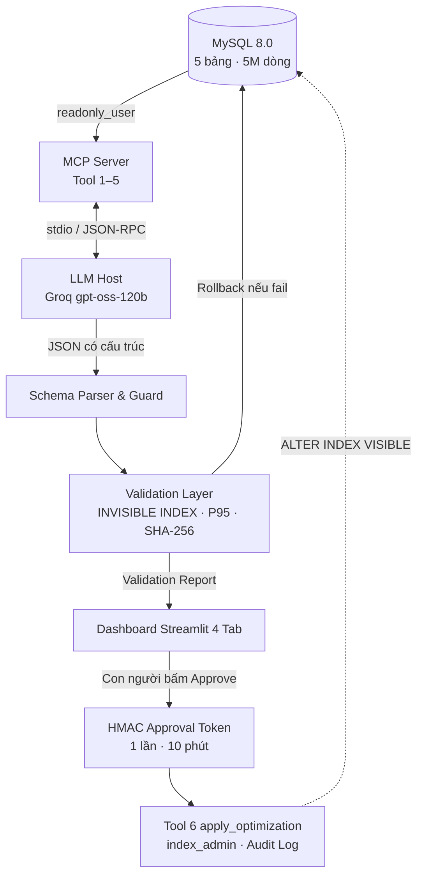

# BÁO CÁO ĐỒ ÁN MÔN HỌC
## Tối ưu Slow Query và Chỉ mục Cơ sở dữ liệu bằng LLM thông qua kiến trúc MCP (Model Context Protocol)

> **Hệ thống:** MCP Slow Query Optimizer  
> **Môi trường thực nghiệm:** MySQL 8.0 (`shopdb.multitable-v1`, 5 bảng, tổng 5.000.000 dòng), Python 3.11+, MCP SDK 2.x (stdio), LLM Groq (`openai/gpt-oss-120b`, `temperature=0.0`), Dashboard Streamlit 4 tab.  
> **Nguyên tắc báo cáo:** Mọi con số dưới đây đều lấy trực tiếp từ bằng chứng đo thật trên lab (`data/outputs/`, `data/metrics/comparison.csv`, `security/injection_report.md`) và nêu trung thực giới hạn thực nghiệm.

---

## Chương 1. Đặt vấn đề và Mục tiêu

### 1.1. Bối cảnh bài toán
Trong các hệ thống thương mại điện tử quy mô lớn, truy vấn chậm (slow query) do thiếu chỉ mục, sai thứ tự cột composite index, hàm bọc cột (non-sargable) hoặc truy vấn lồng (subquery) có thể làm nghẽn toàn bộ CSDL. Đề bài đặt ra bối cảnh sự cố Black Friday trên 12 triệu đơn hàng với CPU 98% do sai thứ tự composite index.

*(Ghi chú phạm vi: bối cảnh 12 triệu đơn hàng / CPU 98% là ngữ cảnh đề bài. Thực nghiệm của nhóm chạy trên lab MySQL 8.0 gồm 5 bảng / tổng 5 triệu dòng, trong đó `orders` có 1,5 triệu dòng và `order_items` có 2,45 triệu dòng; kết quả lab dùng để đối chiếu kỹ thuật, không tuyên bố đã tái hiện sự cố CPU 98% hay downtime.)*

### 1.2. Thách thức khi dùng LLM tối ưu CSDL
1. **Rủi ro sinh lệnh nguy hiểm & ảo giác (hallucination):** Nếu cấp quyền DDL trực tiếp cho LLM, model có thể đề xuất SQL sai ngữ nghĩa, tạo index làm chậm hệ thống, hoặc bị **Prompt Injection** qua comment trong slow log/schema.
2. **Không thể chỉ tin `EXPLAIN query_cost`:** Chi phí ước tính của optimizer đôi khi lệch hoàn toàn so với độ trễ P95 thực tế.
3. **Thiếu chuẩn đánh giá khách quan:** Cần tập 30 query đa dạng kèm ground truth và so sánh công bằng với phương pháp truyền thống (`rule_based`, `greedy`).

### 1.3. Mục tiêu hệ thống
- Xây dựng MCP Server cung cấp **Tool 1–5** (chỉ đọc bằng `readonly_user`) cho LLM phân tích và sinh đề xuất JSON có cấu trúc (`IndexProposal` / `RewriteProposal`).
- Xây dựng **Validation Layer** tự động kiểm chứng bằng **INVISIBLE INDEX** (MySQL 8.0): đo P50/P95 (3 warm-up + 20 lượt), kiểm tương đương kết quả bằng **SHA-256 hash**, tự rollback nếu fail.
- Áp dụng **Human-in-the-loop** qua Dashboard 4 tab: chỉ khi người vận hành bấm **Approve**, backend mới cấp **Approval Token HMAC dùng một lần** (hết hạn 10 phút) để gọi **Tool 6 (`apply_optimization`)** chạy `ALTER INDEX ... VISIBLE` bằng tài khoản `index_admin`. LLM **không bao giờ thấy Tool 6**; đề xuất rewrite chỉ hiển thị, không tự áp dụng.

---

## Chương 2. Kiến trúc Hệ thống và Thiết kế Bảo mật

### 2.1. Kiến trúc tổng thể

### 2.2. Hợp đồng 6 Tool MCP (`docs/api-contract.md` v2)

| # | Tên Tool | Quyền DB | Chức năng chính | LLM thấy? |
| :-: | :--- | :--- | :--- | :-: |
| 1 | `get_slow_queries` | `readonly_user` | Lấy Top N query chậm từ `performance_schema` hoặc `mysql.slow_log` | ✅ |
| 2 | `get_schema` | `readonly_user` | Đọc cấu trúc bảng, cột, khóa ngoại, index hiện có | ✅ |
| 3 | `get_table_stats` | `readonly_user` | Số dòng, cardinality, phân bố mẫu (lấy mẫu giới hạn qua PK) | ✅ |
| 4 | `explain_query` | `readonly_user` | `EXPLAIN FORMAT=JSON` (wrapper LLM chỉ cho `mode=estimate`) | ✅ |
| 5 | `benchmark_query` | `readonly_user` | Đo P50/P95, `rows_examined`, SHA-256 hash kết quả | ✅ |
| 6 | `apply_optimization` | `index_admin` | Đổi index thử sang `VISIBLE`, kiểm token 1 lần & ghi `audit_log` | ❌ Chỉ backend Dashboard |

### 2.3. Kiến trúc bảo mật 6 lớp
1. **Tách quyền DB:** `readonly_user` (chỉ `SELECT`/`EXPLAIN`) cho Tool 1–5; `index_admin` (chỉ `CREATE/DROP/ALTER INDEX` trên `shopdb`) cho helper thử và Tool 6.
2. **Sanitize dữ liệu không tin cậy:** Cắt comment SQL (`strip_sql_comments`), làm sạch comment schema (`sanitize_comment`), lọc tên bảng không hợp lệ trước khi gửi Groq (chặn ca B05), gắn cờ `"untrusted": true`.
3. **AST Whitelist (fail-closed):** Dùng `sqlglot` dialect `mysql`; chỉ cho phép 1 statement `SELECT`/`EXPLAIN`, chặn `;`, `/*!...*/`, `INTO OUTFILE`, `SLEEP()`, `FOR UPDATE`, `EXPLAIN ANALYZE`, truy cập `mysql.*`. (Đã kiểm bằng 47+ unit tests.)
4. **Đề xuất có cấu trúc:** LLM không gửi DDL tự do; server tự sinh DDL từ `{table, columns, index_name}` sau khi kiểm regex `^idx_[a-z0-9_]{1,50}$` và đối chiếu schema.
5. **Approval Token một lần & Audit Log:** Token HMAC gắn với hash của đúng DDL và danh tính DB (`server_uuid`, `schema`, `host`, `port`), hết hạn 10 phút, bị tiêu thụ ngay khi gọi Tool 6; mọi lượt `attempted`/`applied`/`rejected` đều ghi SQLite `audit_log`.
6. **Giới hạn thực thi & bảo vệ FK:** Đặt `MAX_EXECUTION_TIME`, giới hạn tối đa 100 dòng trả về, giới hạn ≤ 5 cột/index; đường runtime mặc định chặn index trùng tiền tố khóa ngoại tham chiếu (`foreign_key_support_risk`), chỉ cho nhánh opt-in trên lab `3309` có marker + snapshot FK.

---

## Chương 3. Thiết kế Thực nghiệm và Dữ liệu

### 3.1. Bộ dữ liệu 5 bảng (`shopdb.multitable-v1`)
- `customers`: 500.000 dòng
- `addresses`: 500.000 dòng
- `products`: 50.000 dòng
- `orders`: 1.500.000 dòng
- `order_items`: 2.450.000 dòng  
Tổng cộng **5.000.000 dòng**, chỉ tạo sẵn index bắt buộc cho PK, UNIQUE và FK (`db/schema.sql`). Hệ thống tách 3 container MySQL 8.0 độc lập: DB chính (`3307`), Validation Lab (`3309`, bản sao 5M có marker `mcp-validation-lab-v1`), và Write Lab (`3308`, đo chi phí INSERT/UPDATE 100k dòng).

### 3.2. Bộ 30 Query chậm và Ground Truth
30 query (`q01`–`q30`, mỗi nhóm 6 query) đều xác nhận có baseline > 0,5s và đã đạt kiểm chứng 30/30 (`scripts/verify_ground_truth.py --check`, 3 warm-up + 20 lượt, hash khớp, P95 giảm ≥ 20%):
- **Nhóm 1 (`q01`–`q06`):** Thiếu index.
- **Nhóm 2 (`q07`–`q12`):** Sai thứ tự cột composite (đã đo đối chứng hoán đổi thứ tự).
- **Nhóm 3 (`q13`–`q18`):** Hàm bọc cột / biểu thức không sargable (yêu cầu Rewrite + Index).
- **Nhóm 4 (`q19`–`q24`):** `SELECT *` + filesort.
- **Nhóm 5 (`q25`–`q30`):** Subquery → JOIN (yêu cầu Rewrite + Index).

---

## Chương 4. Kết quả Thực nghiệm và Phân tích

### 4.1. Thu thập đề xuất LLM trên đủ 30/30 Query
Chạy `scripts/collect_llm_proposals.py` qua Groq (`openai/gpt-oss-120b`, `temperature=0.0`) + MCP Tool 1–5 bằng quyền đọc trên DB chính `3307`: thu được **85 proposal cho 30/30 query** (mọi SQL gốc khớp catalog 100%, mỗi query có ít nhất 1 run thành công).

### 4.2. Kết quả đo thật 12/12 Query nhóm Rewrite (nhóm 3 & 5) trên Lab `3309`
Sử dụng `scripts/measure_llm_rewrite.py` (`--timeout-ms 60000`, 3 warm-up + 20 lượt mỗi phía, tự tạo và dọn index INVISIBLE sau mỗi query):

| Query | Nhóm | Trạng thái | P95 trước → sau (ms) | Thay đổi P95 | Hash / dòng | Ghi chú chính |
| :---: | :-: | :---: | :---: | :---: | :---: | :--- |
| `q13` | 3 | ❌ `failed` | 20.432,37 → 54.047,83 | +164,5% | Khớp (5) | `query_cost` giảm >50% nhưng P95 chậm 2,65× |
| `q14` | 3 | ✅ `passed` | 27.121,31 → 449,14 | **-98,34%** | Khớp (5) | Dùng `orders`, thừa `addresses` |
| `q15` | 3 | ❌ `failed` | 25.800,39 → 54.102,93 | +109,7% | Khớp (5) | `query_cost` giảm >62% nhưng P95 chậm 2,10× |
| `q16` | 3 | ✅ `passed` | 49.259,97 → 16.159,94 | **-67,19%** | Khớp (2) | Dùng cả 2/2 index LLM |
| `q17` | 3 | ✅ `passed` | 54.113,26 → 2.686,19 | **-95,04%** | Khớp (5) | Dùng 1/1 index `order_items` |
| `q18` | 3 | ✅ `passed` | 26.278,30 → 10.544,77 | **-59,87%** | Khớp (2) | Dùng `order_items`, thừa `orders` |
| `q25` | 5 | ✅ `passed` | 50.691,77 → 17.184,15 | **-66,10%** | Khớp (5) | Dùng `idx_orders_customer_total`, thừa `status` |
| `q26` | 5 | ✅ `passed` | 16.867,46 → 12.516,95 | **-25,79%** | Khớp (2) | Dùng cả 2/2 index LLM |
| `q27` | 5 | ✅ `passed` | 33.871,04 → 4.436,66 | **-86,90%** | Khớp (5) | Nhánh FK opt-in + cleanup khớp snapshot |
| `q28` | 5 | ✅ `passed` | 19.660,73 → 6.797,78 | **-65,42%** | Khớp (1) | Dùng `idx_orders_customer_status`, thừa `city` |
| `q29` | 5 | ⚠️ `inconclusive` | 32.537,87 → >60.000 | Timeout | — | Rewrite chạm trần 60s (SQL gốc 32,5s ổn định) |
| `q30` | 5 | ❌ `failed` | 43.029,94 → 38.652,05 | -10,17% | **Lệch hash** | **LLM rewrite sai kết quả (`result_changed`)** |

- **Tỉ lệ đạt nhóm Rewrite:** **8 / 12 = 66,67%** (vượt mức tối thiểu ≥ 60% theo ROADMAP mục 2.4).
- **Bài học thực nghiệm quan trọng (chứng minh giá trị Validation Layer):**
  - **`q13`, `q15` (Thoái hóa P95 dù `query_cost` giảm):** EXPLAIN ước tính cost giảm 50–62%, nhưng P95 thực tế chậm hơn >2×. Điều này chứng minh **không thể chỉ tin LLM hay EXPLAIN cost**, mà bắt buộc phải benchmark P95 thật.
  - **`q30` (Sai ngữ nghĩa khi đổi Subquery → JOIN):** Cùng trả về 1 dòng nhưng SHA-256 hash khác nhau → **kiểm tra hash đã chặn thành công lỗi làm sai dữ liệu**.

### 4.3. So sánh LLM vs 2 Baseline (`data/metrics/comparison.csv` & khâu phát hiện)

| Phương pháp | Đề xuất index (18 query nhóm 1/2/4) | Khớp chính xác | Precision (chính xác) | Recall (chính xác) | Rewrite đạt (nhóm 3 & 5) |
| :--- | :---: | :---: | :---: | :---: | :---: |
| **`llm_groq_mcp`** | 37 | **9** | **24,32%** | **38,89%** (7/18) | **8 / 12 (66,67%)** |
| **`greedy`** *(lab `3309`, `max_cols=2`)* | 11 | 0 | 0,00% | 0,00% | 0 / 12 (0,00%) |

*Lưu ý theo ROADMAP mục 2.5:* Baseline thứ 2 là **`pt-query-digest`** dùng cho khâu **phát hiện/xếp hạng query chậm** (so sánh Top-10 và thời gian phân tích với Tool 1 trên Tab 4 So sánh), không đề xuất index nên không nằm trong bảng Precision/Recall này. `greedy` đạt 0% khớp chính xác vì không tự mở rộng sang covering index 3–4 cột (gồm cột `SELECT`) và không hỗ trợ rewrite SQL.

### 4.4. Phân tích Case Study `q07` & Trade-off Đọc/Ghi
- **Hiệu năng đọc trên lab `3309`:** Index LLM đề xuất `orders(status, order_date, customer_id, total_amount)` giảm P95 từ **2.261,62 → 1.137,69 ms (-49,70%)**, giảm `rows_examined` từ **1.971.386 → 628.511**, hash khớp, 0 timeout.
- **Chi phí ghi trên Write Lab `3308` (100.000 dòng mẫu):**
  - Thông lượng **INSERT** giảm **21,73%** (58.795,88 → 46.018,45 dòng/giây).
  - Một lượt đo bổ sung **UPDATE** trên cột nằm trong index giảm **47,74%** (183.835,90 → 96.067,51 dòng/giây).
  - Dung lượng index ước tính từ `innodb_index_stats`: **~73,07 MB** (`73.072.640` bytes).
- **Quyết định kỹ thuật:** Hiển thị đầy đủ trade-off trên Tab 2 Dashboard để người duyệt cân nhắc; không tự động Approve trên DB chính khi chưa có tải trộn đại diện.

### 4.5. Kết quả kiểm thử Bảo mật & Prompt Injection (`security/injection_report.md`)
- Chạy tự động 20 kịch bản (4 nhóm A/B/C/D × 5) bằng `python -m security.injection_tests.run_tests`: **20/20 ca bị chặn tại ranh giới code đã thử** (9 ca ở lớp lọc comment/prompt, 1 ca B05 ở bộ lọc tên bảng trước Groq + `TrialIndex` guard, 5 ca AST whitelist — đã phát hiện và vá lỗi `EXPLAIN ANALYZE` ở ca C05, 4 ca parser JSON, 1 ca D05 bị chặn ở registry LLM không có Tool 6 và audit ghi `attempted`/`rejected/TOKEN_INVALID`).
- Kiểm thử luồng UI trên lab riêng (`3309`/`3308`): đã xác nhận thành công cả luồng **Validation → Reject (cleanup)** và **Validation → Approve (Tool 6 đổi `VISIBLE`, tiêu thụ 1 token, ghi audit)**, sau đó dọn sạch lab.
- Tổng bộ kiểm thử tự động hiện tại: **379 unit tests pass**, Ruff pass.

---

## Chương 5. Giới hạn Thực nghiệm và Hướng phát triển

### 5.1. Giới hạn nêu trung thực
1. **Nhóm Index 1/2/4:** Mới chấm mức **khớp cấu trúc chính xác**; chưa đo P95 tương đương cho các index khác đáp án nên chưa có Precision/Recall cuối (bao gồm mức tương đương ≤10%), chưa đo đủ Consistency Rate (5 lần lặp) và False Positive Rate toàn bộ.
2. **Kiểm thử Prompt Injection:** 20/20 là kết quả kiểm ranh giới code bằng dữ liệu giả (chỉ ca B05 có probe với Groq thật + MCP giả); chưa tiêm payload thật vào `mysql.slow_log`/schema MySQL để kiểm end-to-end.
3. **Môi trường chính:** Chưa áp dụng index thật trên DB chính `3307` do chưa có workload đọc/ghi đồng thời đại diện.

### 5.2. Hướng phát triển
- Hoàn tất đo P95 tương đương nhóm Index 1/2/4, Consistency Rate 5 lượt và so sánh `pt-query-digest` trên file slow log thực tế.
- Bổ sung đo tải trộn đọc/ghi đồng thời (OLTP + OLAP) để tự động tính điểm lợi ích ròng trước khi đề xuất Approve trên DB chính.
- Hỗ trợ thêm PostgreSQL (dùng `HypoPG` thay cho MySQL `INVISIBLE INDEX`).
